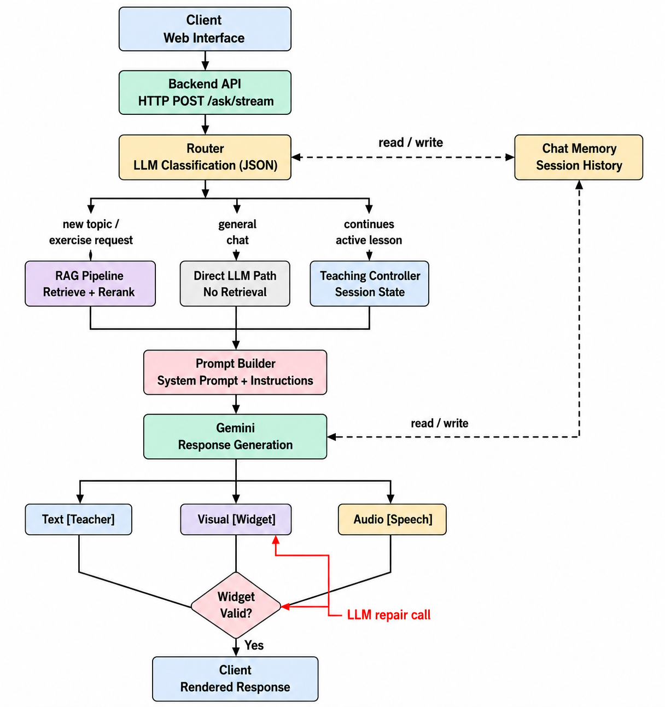

# Prof IA — Arabic math tutor with RAG and interactive diagrams

A tutoring assistant for Tunisian 7ème students. A student asks a question in Arabic
(French words are tolerated) and Prof IA always answers in Arabic. The app finds the
right lesson in the curriculum, explains it **one point at a time**, draws an interactive diagram, speaks the explanation, and
can give exercises and grade the student's answers.

> **Problem it solves:** generic chatbots answer from memory, drift away from the
> school programme and cannot teach step by step. Prof IA answers *only* from the
> curriculum, tracks progress through a lesson, and refuses (politely) topics that
> are not in the programme.


https://github.com/user-attachments/assets/4f53feb6-d54c-4907-9296-2652d235f6c1
[▶ Watch the demo (with voice)](https://github.com/nour-abdessatar/PROF_IA/raw/main/docs/demo.mp4)
## Features

- **Curriculum-grounded answers:** hybrid retrieval (dense + BM25) fused with RRF, then a cross-encoder reranker.
- **Step-by-step teaching:** a session state machine explains one lesson point per turn and asks whether the student understood before moving on.
- **Interactive diagrams:** the model picks a representation from a fixed menu (`registry/`); deterministic layout code computes the geometry, so diagrams do not overlap or drift.
- **Modes:** explanation, continuation, summary (mind map), exercises, answer grading, and combined requests ("give me an exercise and summarize the lesson").
- **Out-of-programme detection:** the router knows the curriculum and declines topics that are not in it.
- **Voice:** ElevenLabs text-to-speech with character alignment (optional).
- **Streaming:** Server-Sent Events, so text appears while the model is still writing.
- **Student and admin spaces:** Supabase authentication, onboarding, level tests, and an admin area to manage courses and multiple-choice tests (React frontend).

## Architecture

   

| Stage | File | What it does |
|---|---|---|
| Ingestion | `json_process.py`, `embedding.py`, `vector_store.py`, `pipeline.py ingest` | Clean and chunk the course JSON, embed with `multilingual-e5-base`, store in Qdrant |
| Routing | `router.py` | One cheap LLM call: intent, mode, extra modes, topic continuity, in-curriculum check |
| Retrieval | `retriever.py`, `reranker.py` | Dense + BM25 fused with RRF, then cross-encoder reranking and lesson selection |
| Teaching | `teaching_controller.py`, `prompt_builder.py` | Session state, per-mode instructions, prompt assembly |
| Generation | `llm.py` | LangChain Gemini chain with model fallback |
| Streaming | `stream_splitter.py`, `stream_handler.py` | Split the stream into sections, build and repair widgets, add audio |
| API | `api.py` | FastAPI app, SSE endpoints |
| Frontend | `frontend/` | React + Vite app; Supabase for auth, database and storage |

Backend code lives in `backend/rag/`, evaluation in `backend/eval/`, the course JSON in `backend/data/`.

### Design decisions

- **Hybrid retrieval + reranker** instead of dense only: curriculum text is short and full of exact terms (symbols, abbreviations such as ق.م.أ) that BM25 catches and embeddings miss.
- **The model chooses a representation, code computes the geometry.** Letting the LLM write pixel coordinates caused overlapping text and detached arcs; a menu of tested layout functions removed that bug class.
- **LLM-based router with the curriculum in its prompt**, instead of keyword rules: keyword pre-checks kept drifting out of sync with each new case (for example "correct exercise 2 in lesson 3").
- **Fail-open streaming:** if the model forgets a tag, the text is still shown instead of an empty bubble.
- **No server-side exercise state:** the model reads the conversation history to find the exercise it gave and count attempts.

## Run it

Requirements: Docker, a Gemini API key, a free Supabase project. About 3 GB of disk for model weights.

### 1. Supabase (frontend auth and data)

1. Create a project on https://app.supabase.com and copy the URL and the anon key (Project Settings, API).
2. In the SQL Editor, run `frontend/supabase/schema.sql` (replace the admin email in it first).
3. For local tests, you can turn off *Confirm email* (Authentication, Providers, Email).

The first account created with `VITE_ADMIN_EMAIL` becomes administrator (`/admin`); other accounts are students.

### 2. Configure and start

```bash
git clone https://github.com/nour-abdessatar/PROF_IA.git && cd PROF_IA
cp backend/rag/.env.example backend/rag/.env   # add your Gemini key (and optional ElevenLabs)
cp frontend/.env.example frontend/.env         # add the Supabase URL and anon key

docker compose --env-file frontend/.env up --build
docker compose run --rm backend python pipeline.py ingest --input data/mathgeo.json

# app: http://localhost:8080   API: http://localhost:8001
```

The first start downloads the embedding and reranker models (cached in a Docker volume).

### Without Docker

```bash
cd backend/rag && python -m venv .venv && source .venv/bin/activate
pip install -r requirements.txt
python pipeline.py ingest --input ../data/mathgeo.json
uvicorn api:app --port 8001
# in another terminal
cd frontend && npm install && npm run dev
```

Frontend variables (`frontend/.env`): `VITE_SUPABASE_URL`, `VITE_SUPABASE_ANON_KEY`, `VITE_ADMIN_EMAIL`, `VITE_API_BASE` (the backend, `http://localhost:8001`).

### Data

The course JSON used by the app is `backend/data/mathgeo.json`. <!-- TODO: add its source, e.g. "Based on the official Tunisian 7ème programme". -->

### Configuration

See `backend/rag/.env.example`. Keys: `GEMINI_API_KEY` / `GOOGLE_API_KEY` (required), `ELEVENLABS_API_KEY` + `ELEVENLABS_VOICE_ID` (optional audio), `LANGSMITH_*` (optional tracing), `CURRICULUM_JSON`, `OOP_MIN_SCORE`.

## Evaluation

Small, hand-built test sets, run against the real pipeline:

| What | Test set | Result |
|---|---|---|
| Router accuracy (intent / mode) | 38 hand-written questions covering all 6 intents | 100% |
| Retrieval (hybrid + reranker) | 30 queries, each with a known correct lesson | Recall@4 = 100%, MRR = 0.961 |
| Groundedness | 6 live answers scored by an LLM judge against the retrieved lesson | 6 / 6 grounded |
| Latency | end-to-end answer | 12.7 s mean |

How to read these numbers: the questions were written by the author, on a single
subject with a small curriculum, so they show the pipeline works on the cases it was
designed for. They are not a claim of 100% accuracy on real students' questions
(spelling mistakes, dialect, vague questions). The groundedness check is only 6
answers. <!-- TODO: say where the latency was measured (CPU or GPU, which Gemini model, with or without TTS). -->

Reproduce (scripts and datasets in `backend/eval/`, reports in `backend/eval/reports/`):

```bash
cd backend/eval
export PYTHONPATH=../rag GEMINI_API_KEY=your_key    # PowerShell: $env:PYTHONPATH="../rag"
python router_eval.py --dataset datasets/router_eval_set.json
python retrieval_eval.py --dataset datasets/retrieval_eval_set.json --k 4
python groundedness_eval_batched.py --dataset datasets/groundedness_live_set.json --mode live
```

The retrieval evaluation needs the course to be ingested first.

## Known limitations

- Embedded Qdrant allows one process on its folder, so the API runs with a single worker. Use a Qdrant server for more.
- Answers are in Arabic only for now (7ème, Arabic-medium); French support was removed on purpose and may return for lycée.
- `select_relevant_lessons` assumes best-first order but receives reordered chunks (see the TODO in `pipeline.py`).
- The evaluation sets are small and hand-written (see above).

## Tech stack

Python, FastAPI, Qdrant, sentence-transformers, BGE reranker, Gemini (LangChain), ElevenLabs, LangSmith, React, Vite, TypeScript, Tailwind, shadcn/ui, Supabase, Docker.

The first version of the frontend UI was scaffolded with Lovable, then adapted to the backend.
